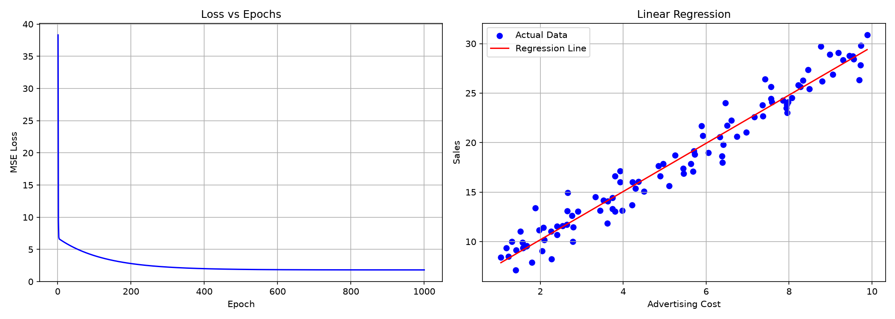

# Gradient Descent with NumPy

## 1. Giới thiệu

Bài thực hành tự triển khai thuật toán Gradient
Descent để dự đoán doanh số bán hàng dựa trên
chi phí quảng cáo.

Ngôn ngữ: Python
Thư viện: NumPy, Matplotlib
Công cụ: Visual Studio Code

## 2. Nội dung bài thực hành

### Task 1
Viết hàm tính MSE Loss và Gradient.

### Task 2
Xây dựng thuật toán Gradient Descent
với Learning Rate = 0.01 và 1000 Epoch.

### Task 3
Vẽ biểu đồ Loss theo Epoch và
đường hồi quy tuyến tính.

### Task 4
So sánh ba Learning Rate:
0.0001, 0.01 và 0.15.

## 3. Hướng dẫn chạy

Cài thư viện:

    pip install -r requirements.txt

Chạy chương trình:

    python main.py

## 4. Kết quả

Sau 1000 Epoch:

- w = 2.4367
- b = 5.3122
- MSE = 1.8164

Phương trình dự đoán:

y = 2.4367 * X + 5.3122

## 5. Biểu đồ

## 6. Kết luận

Learning Rate ảnh hưởng trực tiếp đến
quá trình hội tụ của Gradient Descent.

Learning Rate quá nhỏ khiến mô hình học chậm.
Learning Rate quá lớn có thể gây phân kỳ.
Giá trị 0.01 phù hợp với bài thực hành này.
